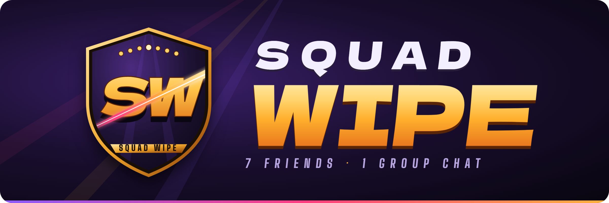
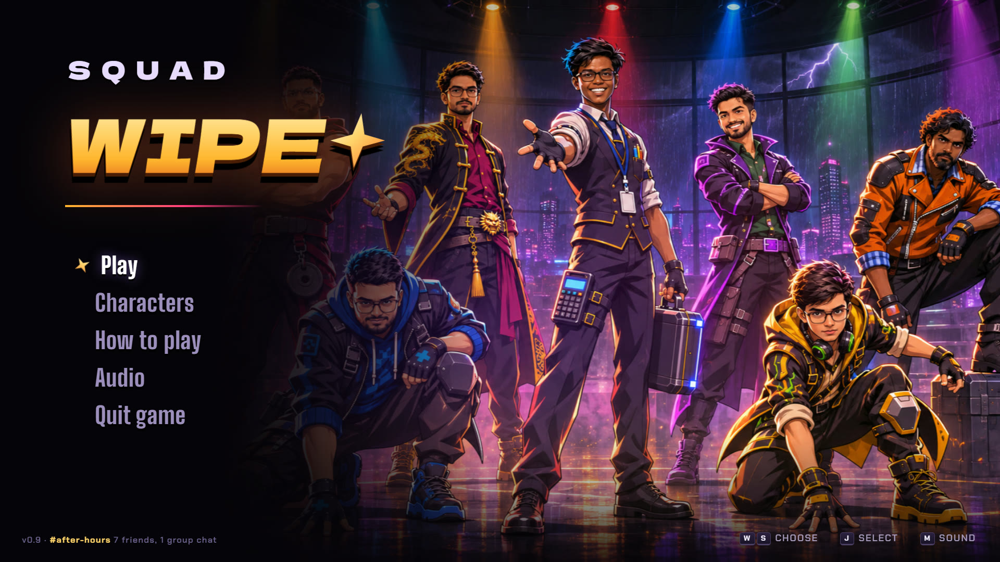
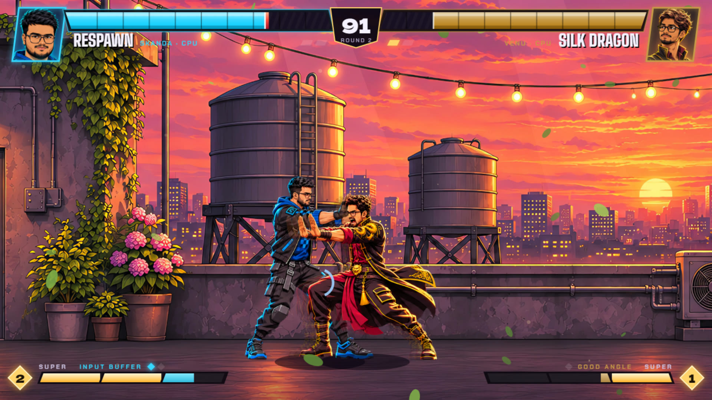



<b>7 friends. 1 group chat. Somebody's getting wiped.</b>

Squad Wipe is a 2D fighting game where every fighter is one of us. Each one has their own moves, combos, a special meter that works differently for every character, and a full ultimate cutscene. Fight the CPU, fight each other on one keyboard or with controllers, or run Arcade and beat the whole squad.

  

  

## ⬇️ Download

**[Get the latest version here](https://github.com/skandasandy24/SQUAD-WIPE-GAME/releases/latest)**. Download `SquadWipe-Setup-x.x.x.exe` from *Assets*.

1. Run the installer. If Windows says **"Windows protected your PC"**, click **More info → Run anyway**. That's only because the game isn't code-signed.
2. Choose where to install, finish, and open **Squad Wipe** from the desktop or Start menu.

Windows 10/11 · about 300 MB · plays offline (it only goes online to check for updates).

## 🔄 Updates

You never need to download it again. When a new version is out, the game downloads it in the background and shows **UPDATE READY**, at the top of the screen and on the main menu:
- click **RESTART NOW** (or press **F8**, or hold **Select + Start** on a controller), or
- just keep playing: it installs when you close the game.

**Main menu → Updates** shows your version and lets you **Check for updates** right away, or **Reinstall latest version** if something's broken (it downloads the newest version again and reinstalls it in place).

## 🥊 The squad

| Fighter | Who | Style | Ultimate |
|---|---|---|---|
| **RESPAWN** | Skanda, *The Gamer* | All-rounder with branching hit confirms | Everyone Gets a Turn |
| **JUMP CUT** | Abhinav, *The Editor* | Setplay and delayed traps | The Outtakes Stay In |
| **DEADLIFT** | Bala Krishna, *The Gym Rat* | Close-range grappler | Put It Back on the Rack |
| **HASHRATE** | Ganesh, *The Cryptominer* | Projectile zoner who manages his heat | Room-Temperature Miracle |
| **REDLINE** | Lokeshwar, *The Rider* | Momentum rushdown and feints | Last Exit for Chai |
| **OVERTIME** | Sharath, *The One With The Job* | Defensive, midrange, turn-taking | Balance Sheet |
| **SILK DRAGON** | Venu, *The Handsome* | Footsies and counterattacks | One for the Mantelpiece |

Every fighter has 5 special moves, a super, an ultimate with its own cinematic, and a home stage.

## 🎮 Modes

- **Arcade**: beat the other six in a row. Each fight is harder than the last.
- **VS CPU**: Easy, Normal or Hard.
- **VS Friend**: two players on one PC, with a running head-to-head record.
- **Training**: dummy settings, hitbox view, input display and frame advantage.

## 🕹️ Controls

- **Controllers: fully supported.** Plug in up to two Xbox, PlayStation or other standard pads. They work in every menu, and pads **rumble** on hits, blocks, throws and K.O.s.
- **The game shows your buttons:** it detects whether you're on a keyboard, an Xbox controller or a PlayStation controller, and every menu, move list and the controls screen show that device's buttons. Switch any time.
- **Keyboard:** both players can share one keyboard. Player 2 doesn't need a numpad.
- Three control styles: **MK** (front/back punch and kick, the default), **Simple** (easy specials) and **Pro**.
- **F11** fullscreen · **M** mute · full move lists in the game under *How to play* and in the pause menu.

These tables are for the default **MK** style.

### ⌨️ Keyboard

| Action | Player 1 | Player 2 |
|---|---|---|
| Move · jump · crouch | `A` `D` · `W` · `S` | `←` `→` · `↑` · `↓` |
| Front punch · back punch | `J` · `I` | `.` · `;` |
| Front kick · back kick | `K` · `L` | `/` · `'` |
| Block (hold) | `O` | `]` or `Right Shift` |
| Super / Ultimate | `U` | `[` |
| Grab | `Space` | `\` or `Num0` |
| Pause · move list | `Esc` | `Esc` |
| In pause: quit to menu | `Q` | `Q` |

### 🟢 Xbox controller

| Action | Button |
|---|---|
| Move · jump · crouch | D-pad or left stick |
| Front punch · back punch | **X** · **Y** |
| Front kick · back kick | **A** · **B** |
| Block (hold) | **RB** or **RT** |
| Super / Ultimate | **LB** or **LT** |
| Grab | **LS** or **RS** (click a stick) |
| Pause · move list | **Menu** |
| In pause | **B** back to the fight · **Y** quit to menu |
| Menus | **A** select · **B** back |

### 🔵 PlayStation controller

| Action | Button |
|---|---|
| Move · jump · crouch | D-pad or left stick |
| Front punch · back punch | **□ Square** · **△ Triangle** |
| Front kick · back kick | **✕ Cross** · **○ Circle** |
| Block (hold) | **R1** or **R2** |
| Super / Ultimate | **L1** or **L2** |
| Grab | **L3** or **R3** (click a stick) |
| Pause · move list | **Options** |
| In pause | **○** back to the fight · **△** quit to menu |
| Menus | **✕** select · **○** back |

## ✨ Also in the game

Throw escapes · combo counter · PERFECT rounds · intro and victory lines · rivalry lines on the versus screen · announcer · mirror-match markers.
